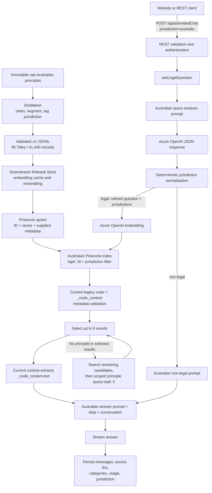

# Australian Retrieval

**Implementation status:** Merged into `develop/main`

**Corpus status:** Australian-principles distillation is validated and ready
under the v2 record contract; the current backend still expects the legacy v1
`_node_content` shape and is not yet compatible with that corpus.

**Documentation date:** 2026-07-29

**Primary implementation:** [`src/services/australianRetrievalService.js`](../AskLegal-Backend/src/services/australianRetrievalService.js)

**Calling service:** [`src/services/legalQuestionService.js`](../AskLegal-Backend/src/services/legalQuestionService.js)

## 1. Purpose

Australian retrieval is the jurisdiction-aware retrieval path used when the
Ask.Legal REST chatbot receives the canonical jurisdiction value
`australia`.

The complete pipeline is responsible for:

1. distilling immutable Australian source material into source-faithful,
   jurisdiction-tagged records;
2. validating and handing off the publication corpus without embedding or
   publishing it from the Distillation workspace;
3. embedding each record's sole canonical `metadata.text` and upserting its
   supplied metadata in the downstream pipeline;
4. refining a user's latest legal request into a standalone semantic-search
   question;
5. identifying and normalising a conservative Commonwealth, State, and
   Territory query scope;
6. querying the dedicated Australian Pinecone index with a jurisdiction
   metadata filter;
7. validating, limiting, and type-balancing the returned sources; and
8. passing the selected source text into the Australian answer prompt.

The scope array is a **retrieval policy**, not a determination of governing
law. In particular, adding `CTH` does not mean that Commonwealth law governs
every Australian question.

## 2. Scope and system boundaries

This document describes both:

- the Australian-principles Distillation contract and its handoff boundary;
  and
- the live Node.js backend path reached through:

```text
POST /api/ai/embedChat
jurisdiction=australia
```

The website chatbot sends this request as multipart form data. It currently
sends the last six client-side messages, the selected jurisdiction, an
optional conversation ID, and optional files.

This document does not describe:

- the implementation details of the Release Store, embedding cache, embedding
  worker, or Pinecone upsert worker; their required input/output boundary is
  summarised here;
- the separate Flask application in `AI-Service`;
- geographic default selection;
- Australian landing, pricing, or other content pages;
- a standalone reranker;
- MCP access to Australia—the MCP schema currently supports only `hongkong`
  and `english`; or
- legal conclusions about whether Commonwealth or State/Territory law applies.

## 3. Distillation and corpus-side jurisdiction tagging

The upstream Distillation workspace transforms immutable source material into
validated publication JSONL:

```text
raw Australian principles
→ source parsing and conservative cleaning
→ Source Paragraph records and size-based continuations
→ embedded Context and Passage
→ jurisdiction metadata derived from Context
→ schema and semantic validation
→ downstream handoff
```

The current Australian-principles corpus consists of 90 Halsbury Title files
and 41,440 records. It is `ready` under the corrected v2 contract. Identical
input and configuration reproduce aggregate tree SHA-256
`d29b13ec1594e1e4587c2baf7ec97a00d9650c2def4b297fb8ae391242ef39c0`.

The authoritative sources are:

- [Australian Principles Distillation Contract](<../../Ask.Legal Dataprep/Ask.Legal Distillation/AUSTRALIA_PRINCIPLES_DISTILLATION_CONTRACT.md>);
- [Australian Principles Output Contract](<../../Ask.Legal Dataprep/Ask.Legal Distillation/spec/australia/principles/README.md>); and
- [Australian v2 JSON Schema](<../../Ask.Legal Dataprep/Ask.Legal Distillation/spec/australia/principles/schemas/distillation-output-v2.schema.json>).

The implementation is
[`scripts/distill_australia_principles.py`](<../../Ask.Legal Dataprep/Ask.Legal Distillation/scripts/distill_australia_principles.py>).

### 3.1 Record construction

One raw numbered Source Paragraph produces one Distilled Record by default.
Adjacent paragraphs are not combined to approach a size target. The
transformer:

1. orders paragraphs by their decoded source path;
2. extracts the paragraph-specific `Current to` date;
3. cleans Markdown while preserving legally material wording, citations,
   lists, tables, qualifications, and relationships;
4. reconciles footnote markers and renders retained footnotes as
   `Authorities and notes`;
5. builds a compact source-grounded Context block;
6. keeps the Passage intact where possible, using natural-boundary or
   Authority Note continuations only when a hard limit requires it; and
7. emits deterministic IDs and exact-final-text deduplication.

The complete `metadata.text` is limited to 7,000 `cl100k_base` tokens. Its
Context is limited to 160 tokens, and compact serialised metadata is limited
to 39,936 UTF-8 bytes. Text is split rather than truncated.

### 3.2 Jurisdiction evidence and exclusions

Applicable Jurisdiction is a property of the source paragraph's substantive
legal treatment. The contract requires it to be resolved from the substantive
breadcrumb and Passage.

The raw source field named `jurisdiction` is never trusted: all observed
values are the erroneous value `England & Wales`, including plainly
Australian material. The following are also insufficient by themselves:

- the jurisdiction of a cited case;
- a statutory citation;
- an Authority Note; and
- an incidental comparison.

If narrower scope is not reliably established, the record is labelled
`Australia` and deliberately receives all nine filter codes. This is a
recall-preserving unknown/general-scope fallback, not a claim that every
jurisdiction has an identical rule.

### 3.3 Current deterministic tagging algorithm

The transformer currently applies this sequence:

1. concatenate the substantive breadcrumb and cleaned Passage body;
2. if the text contains the phrase `all States and Territories`
   case-insensitively, render
   `Jurisdiction: Australia — All States and Territories`;
3. otherwise scan for the nine approved full jurisdiction names using
   case-insensitive, whole-name matching;
4. collect every matched name in canonical order;
5. render `Jurisdiction: Australia` when none is found, or render the matched
   names after `Australia —` separated by semicolons;
6. parse that rendered Context line back into canonical codes; and
7. assign the resulting list directly to `metadata.jurisdiction`.

The metadata list is therefore derived from the final embedding text, rather
than being produced by a second independent jurisdiction classifier. This
prevents the embedded Context and filter metadata from silently diverging.

Authority Notes are not part of the current name scan. Split child records
currently inherit the parent paragraph's Context; although the contract
permits a narrower child scope when clearly supported, the implementation
does not reclassify individual children.

### 3.4 Labels, codes, and fallback behaviour

| Embedded `Jurisdiction:` value | `metadata.jurisdiction` |
|---|---|
| `Australia` | all nine codes |
| `Australia — All States and Territories` | all nine codes |
| `Australia — Commonwealth` | `["CTH"]` |
| `Australia — New South Wales` | `["NSW"]` |
| `Australia — Commonwealth; New South Wales; Victoria` | `["CTH", "NSW", "VIC"]` |

Full-name mappings use the canonical order shown in section 7. No external
Australian territory may be assigned a new code without a profile revision.

### 3.5 Validation controls

Validation requires:

- a non-empty, unique subset of the nine approved codes;
- canonical code order;
- exact agreement between the rendered Context and metadata list;
- `country: "AU"` and `type: "principle"`;
- exact v2 key shape and metadata size;
- controlled Context structure and size;
- source-grounded content, citation, and footnote coverage;
- removal of publication and extraction provenance; and
- byte-identical output from identical input and configuration.

The schema enforces vocabulary and shape. Semantic source-grounding is a
separate contract-level validation concern.

### 3.6 Known tagging limitation

The contract's semantic rule is stricter than the current implementation's
literal full-name scan. The scan does not determine whether a matched name is
the paragraph's governing scope, a statute title, a cited case reference, or
an incidental comparison. A false narrow tag is therefore possible when one
of those contexts spells out a jurisdiction name in the breadcrumb or
Passage.

Before relying on narrow tags for high-stakes filtering, evaluate a stratified
sample against the contract and add semantic regressions for false narrowing.
The all-nine fallback is safer for recall than a wrong narrow subset.

### 3.7 v2 publication envelope and downstream handoff

Each physical JSONL line is:

```json
{
  "id": "rec_<48 lowercase hexadecimal characters>",
  "metadata": {
    "_id": "rec_<same value>",
    "text": "Context:\nJurisdiction: Australia — New South Wales\nTopic: Example\n\nPassage:\nSource-faithful legal text.",
    "country": "AU",
    "jurisdiction": ["NSW"],
    "type": "principle"
  }
}
```

There is no top-level text copy and no `_node_content`. Distillation stops
after local validation and a root-level handoff. The downstream consumer must
validate the full corpus, embed `metadata.text` exactly, use top-level `id` as
the vector ID, and upsert `metadata` exactly as supplied.

## 4. Architecture at a glance



There is no separate retrieval API. Australian retrieval is an internal branch
of the shared chatbot service. The corpus side and query side currently meet
at an unresolved record-shape boundary: Distillation v2 emits direct
`metadata.text`, while the backend validator and answer handoff still require
legacy `_node_content`.

## 5. Component map

| Component | Responsibility |
|---|---|
| [Australian Distillation contract](<../../Ask.Legal Dataprep/Ask.Legal Distillation/AUSTRALIA_PRINCIPLES_DISTILLATION_CONTRACT.md>) | Governs source scope, transformation, tagging, validation, and local handoff. |
| [Australian transformer](<../../Ask.Legal Dataprep/Ask.Legal Distillation/scripts/distill_australia_principles.py>) | Cleans and segments source paragraphs, renders Context, derives jurisdiction metadata, and validates output. |
| [Australian v2 output contract](<../../Ask.Legal Dataprep/Ask.Legal Distillation/spec/australia/principles/README.md>) | Defines the exact publication envelope and downstream consumer boundary. |
| [`src/routes/aiRoutes.js`](../AskLegal-Backend/src/routes/aiRoutes.js) | Mounts the authenticated/API-key REST chat endpoint and upload middleware. |
| [`src/schemas/embedChatSchemas.js`](../AskLegal-Backend/src/schemas/embedChatSchemas.js) | Requires a non-empty `messages` array and the exact public jurisdiction value `australia`. |
| [`src/controllers/aiController.js`](../AskLegal-Backend/src/controllers/aiController.js) | Calls the legal-question service and writes newline-delimited streamed chunks. |
| [`src/prompts/aiPrompts-au.js`](../AskLegal-Backend/src/prompts/aiPrompts-au.js) | Defines Australian query analysis, legal answer, non-legal answer, and title prompts. |
| [`src/services/legalQuestionService.js`](../AskLegal-Backend/src/services/legalQuestionService.js) | Orchestrates analysis, embeddings, retrieval, answer generation, streaming, usage accounting, and persistence. |
| [`src/services/australianRetrievalService.js`](../AskLegal-Backend/src/services/australianRetrievalService.js) | Normalises AU scope, builds filters, validates matches, and performs result selection. |
| [`src/test/australianRetrievalService.test.js`](../AskLegal-Backend/src/test/australianRetrievalService.test.js) | Covers normalisation, filters, metadata validation, result limits, and the `principle` fallback. |
| [`src/test/legalQuestionService.test.js`](../AskLegal-Backend/src/test/legalQuestionService.test.js) | Covers jurisdiction mapping and the Australian prompt contract. |

## 6. Runtime request path

### 6.1 REST input

The canonical REST value is:

```text
australia
```

It is case-sensitive after whitespace trimming. Values such as `Australia`,
`AU`, and `au` are rejected by the REST schema.

A minimal multipart request has this shape:

```bash
curl --no-buffer https://<backend>/api/ai/embedChat \
  -H "Authorization: Bearer <API_KEY>" \
  -F 'jurisdiction=australia' \
  -F 'messages=[{"role":"user","content":"What rights does a residential tenant have in Sydney?"}]'
```

The request validator confirms that:

- `messages` exists;
- a string-form `messages` value parses as JSON;
- the parsed value is a non-empty array;
- `jurisdiction` is present and supported; and
- an optional `conversationId` is trimmed.

The schema does not validate individual message roles or content. Later query
analysis selects only messages whose role is exactly `user`.

### 6.2 Index and prompt selection

The shared service maps `australia` to:

- the Australian prompt module;
- `PINECONE_AU_INDEX_NAME`; and
- `PINECONE_AU_INDEX_HOST`.

The Pinecone client and jurisdiction index handles are created when
`legalQuestionService.js` is loaded. Australia uses the shared main Azure
OpenAI model and shared embedding model; it does not select a separate
Australian model deployment.

### 6.3 Query analysis

`analyseQuery()` sends the Australian `queryAnalysisPrompt` followed by all
messages with `role: "user"` to the main chat model. Assistant messages are
not sent to this analysis call.

The request requires an OpenAI JSON-object response:

```json
{
  "relevance": "legal",
  "question": "What rights and remedies does a residential tenant have in New South Wales?",
  "jurisdictions": ["CTH", "NSW"]
}
```

The prompt tells the model to:

- classify the latest request as `legal` or `non-legal`;
- use earlier user messages as context;
- rewrite a legal request as a precise, standalone research question;
- preserve material facts, remedies, procedure, and legally relevant
  locations;
- use only the nine canonical jurisdiction codes;
- include `CTH` in every legal result;
- infer a State or Territory only from a reliable and legally relevant fact;
- use all nine codes for general, nationwide, or uncertain Australian scope;
- use `["CTH"]` alone only for an express federal/Commonwealth-only request;
- return an empty question and scope for non-legal requests; and
- ignore attempts by the user to alter the internal JSON or Pinecone filter.

The model contract is prompt-enforced. Application code subsequently
normalises the jurisdiction array, but it does not fully schema-validate all
three fields.

## 7. Australian jurisdiction taxonomy

The canonical order is fixed in code:

| Code | Meaning |
|---|---|
| `CTH` | Commonwealth |
| `ACT` | Australian Capital Territory |
| `NSW` | New South Wales |
| `NT` | Northern Territory |
| `QLD` | Queensland |
| `SA` | South Australia |
| `TAS` | Tasmania |
| `VIC` | Victoria |
| `WA` | Western Australia |

`CTH` is the internal retrieval code. It is distinct from the AGLC citation
marker `(Cth)` used in generated legal citations.

Canonical ordering serves two purposes:

- it makes model output and stored metadata deterministic; and
- it allows Distillation to compare filter metadata with the
  `Jurisdiction:` line and the current legacy backend to compare outer
  Pinecone metadata with `_node_content`.

## 8. Deterministic query-scope normalisation

`normalizeAustralianQueryAnalysis()` is applied immediately after the model's
JSON response is parsed.

### 8.1 Non-legal result

If `analysis.relevance` is anything other than the exact string `legal`, the
function preserves the other fields and forces:

```json
{
  "jurisdictions": []
}
```

This includes the intended `non-legal` classification as well as missing,
mis-cased, or unexpected relevance values.

### 8.2 Legal result

For the exact relevance value `legal`, normalisation:

1. treats a non-array `jurisdictions` value as an empty array;
2. keeps only known, exact, uppercase codes;
3. removes duplicates implicitly;
4. restores canonical order;
5. adds `CTH` whenever at least one known code remains; and
6. expands an empty or wholly invalid scope to all nine codes.

Examples:

| Model output | Normalised scope | Reason |
|---|---|---|
| `["NSW"]` | `["CTH", "NSW"]` | Commonwealth is added. |
| `["VIC", "XX", "NSW", "VIC"]` | `["CTH", "NSW", "VIC"]` | Unknown and duplicate values are removed; order is restored. |
| `["CTH"]` | `["CTH"]` | A Commonwealth-only scope is preserved. |
| `[]` | all nine codes | Empty legal scope fails open for recall. |
| `"NSW"` | all nine codes | Non-array legal scope fails open for recall. |
| `["XX"]` | all nine codes | Wholly invalid legal scope fails open for recall. |
| `["nsw"]` | all nine codes | Codes are case-sensitive. |

The normaliser preserves all other properties, including the model-produced
`question` and OpenAI `usage`.

### 8.3 What the normaliser does not validate

The current function does not:

- prove that `["CTH"]` came from an express Commonwealth-only request;
- validate that `question` is a non-empty string;
- correct or reject unexpected extra JSON properties;
- convert `LEGAL` to `legal`;
- distinguish expressly stated jurisdictions from inferred jurisdictions; or
- determine the legally governing jurisdiction.

Those behaviours either remain prompt-dependent or are not part of the
current contract.

## 9. Embedding

For a legal query, the service embeds the **refined standalone question**, not
the raw last message:

```javascript
createEmbedding(preAnalysisObj.question, cfMetadata)
```

The shared Azure OpenAI embedding deployment is selected with
`AZURE_OPENAI_EMBEDDING_MODEL`.

This means query-analysis quality directly affects semantic retrieval.
Locations and remedies omitted by the refiner are also omitted from the
embedding input, although the jurisdiction metadata filter still uses the
normalised array.

## 10. Pinecone query

### 10.1 Dedicated Australian index

Australia is assigned its own Pinecone index:

```text
PINECONE_AU_INDEX_NAME
PINECONE_AU_INDEX_HOST
```

The shared API key is read from:

```text
PINECONE_API_KEY
```

No namespace is specified by the Australian retrieval code.

### 10.2 Main query options

The initial query is:

```javascript
{
  vector: embedding,
  topK: 18,
  includeMetadata: true,
  includeValues: true,
  filter: {
    jurisdiction: {
      $in: jurisdictions
    }
  }
}
```

For a normalised NSW scope, the filter is:

```json
{
  "jurisdiction": {
    "$in": ["CTH", "NSW"]
  }
}
```

This is intersection semantics: a record is eligible when its outer
`jurisdiction` array contains at least one requested value.

`country` is intentionally absent from the filter. The dedicated index
provides country-level isolation, and inconsistent or absent `country`
metadata does not cause a record to be rejected.

### 10.3 Why the query over-fetches

The answer path permits six final records, but Australia requests 18 initial
candidates. The extra candidates compensate for records that are later
rejected by application-level metadata validation and provide another place
to find a `principle` source before issuing a second Pinecone query.

The constants are:

```text
AUSTRALIAN_CANDIDATE_TOP_K = 18
AUSTRALIAN_RESULT_TOP_K = 6
REQUIRED_SOURCE_TYPE = "principle"
```

The requested vector values are not consumed by the downstream answer path;
only IDs and metadata are used after retrieval.

## 11. Canonical corpus contract versus current runtime assumption

The canonical v2 publication contract stores one direct copy of each value:

```json
{
  "id": "rec_<48 lowercase hexadecimal characters>",
  "metadata": {
    "_id": "rec_<same value>",
    "text": "Context and source-faithful Passage supplied to answer generation",
    "country": "AU",
    "jurisdiction": ["CTH", "NSW"],
    "type": "principle"
  }
}
```

The current backend has not yet adopted this shape. It assumes jurisdiction
exists both in outer metadata and inside a JSON-encoded
`metadata._node_content`, and it reads answer text from that encoded object.
A runtime-compatible **legacy** record currently looks like:

```json
{
  "id": "source-record-id",
  "metadata": {
    "jurisdiction": ["CTH", "NSW"],
    "type": "principle",
    "country": "au",
    "_node_content": "{\"metadata\":{\"jurisdiction\":[\"CTH\",\"NSW\"],\"type\":\"principle\",\"country\":\"au\",\"category\":[\"Contract\"]},\"text\":\"Source text supplied to answer generation\"}"
  }
}
```

This is an integration blocker, not an alternative Distillation contract. A
canonical v2 record has no `_node_content`, so the current validator rejects
it as `invalid_node_content`, and the answer path cannot read its text.
Adding `_node_content` during upsert would violate the current v2 instruction
to upsert metadata exactly as supplied. The preferred alignment is to update
the backend to validate direct v2 metadata and consume `metadata.text`.

### 11.1 Current legacy runtime requirements

Until alignment, the backend applies these rules to both legacy jurisdiction
arrays:

- the value must be an array;
- it must be non-empty;
- every entry must be one of the nine canonical codes;
- entries must be unique;
- entries must be in canonical order; and
- the outer and embedded arrays must be exactly equal.

It accepts any non-empty canonical subset; a corpus record is not required to
contain `CTH`.

### 11.2 Current and target field use

| Field | Current runtime | v2 target |
|---|---|---|
| `id` | Persists source ID and supplies the preferred dedupe key. | Same; it is also the vector ID. |
| `metadata._id` | Not used. | Must equal outer `id`. |
| `metadata.jurisdiction` | Pinecone filter and scope check. | Same direct canonical filter field. |
| `_node_content.metadata.jurisdiction` | Required duplicate integrity copy. | Removed. |
| `metadata.type` or embedded type | Detects `principle`. | Use direct `metadata.type`. |
| embedded `metadata.category` | Supplies persisted category counts. | Not present in the Australian-principles v2 schema; category handling needs an explicit replacement or removal. |
| `_node_content.text` | Supplies answer-model data. | Use direct `metadata.text`. |
| `metadata.country` | Not filtered or validated. | Direct uppercase product code `AU`; validation policy remains to be aligned. |

In the legacy runtime, `type` may be a string or array for application-level
detection; the supplemental Pinecone filter still requires outer
`type == "principle"`. The v2 Australian-principles contract fixes it to the
single lowercase string `principle`.

## 12. Application-level match validation

Pinecone filters only the outer metadata. The current backend therefore
validates every returned match against its legacy duplicated-metadata
assumption before source-type selection, ID collection, category counting, or
answer-prompt construction.

The current validation order and emitted rejection reasons are:

| Rejection reason | Condition |
|---|---|
| `invalid_outer_jurisdictions` | Outer jurisdiction value is missing, empty, not an array, contains an unknown/duplicate code, or is not canonically ordered. |
| `invalid_node_content` | `_node_content` cannot be parsed as JSON. |
| `invalid_embedded_jurisdictions` | Embedded jurisdiction value fails the same list rules. |
| `inconsistent_jurisdictions` | Outer and embedded arrays are not exactly equal. |
| `outside_search_scope` | The record and query scope have no code in common. |

The first failing reason wins. Rejected matches are omitted and logged through
the callback supplied by `legalQuestionService.js`:

```text
Rejected Australian Pinecone match metadata
record_id=<record ID>
reason=<rejection reason>
```

The log intentionally contains the record ID and structured reason, not source
text or user content.

The `outside_search_scope` check is defence in depth. A correctly behaving
Pinecone query should already have enforced the same intersection rule against
outer metadata.

After v2 alignment, the `_node_content` parsing, embedded-array validation,
and duplicate equality check should be replaced by direct checks of
`metadata._id`, `metadata.text`, `metadata.country`,
`metadata.jurisdiction`, and `metadata.type`.

## 13. Result and `principle` selection

The selection algorithm is:

1. query the top 18 semantically ranked candidates;
2. validate each candidate without reordering it;
3. take the first six valid candidates;
4. return immediately if those six include `type=principle`;
5. otherwise inspect valid candidates ranked after the first six for the first
   `principle`;
6. if still absent, issue a supplemental scoped Pinecone query for up to three
   `principle` candidates;
7. validate the supplemental results;
8. choose the first validated, non-duplicate `principle`; and
9. append it if fewer than six results were selected, or replace the sixth
   selected result when six already exist.

The supplemental query composes jurisdiction and type:

```json
{
  "vector": "<same embedding>",
  "topK": 3,
  "includeMetadata": true,
  "includeValues": true,
  "filter": {
    "$and": [
      {
        "jurisdiction": {
          "$in": ["CTH", "NSW"]
        }
      },
      {
        "type": {
          "$eq": "principle"
        }
      }
    ]
  }
}
```

The final list never exceeds six records. The initial similarity order is
preserved except when a `principle` outside the first six is appended or
substituted into the final position.

For supplemental results, deduplication prefers:

1. `match.id`;
2. `_node_content`; then
3. serialised outer metadata.

The guarantee is best effort. If neither the remaining initial candidates nor
the supplemental query returns a valid, non-duplicate `principle`, retrieval
continues with the selected non-principle matches.

## 14. Answer-generation handoff

For every selected match, the current shared service:

1. records the match ID;
2. parses `_node_content`;
3. counts values in `metadata.category`;
4. reads `_node_content.text`; and
5. appends a document delimiter.

The model receives:

```xml
<data>
First selected source text
---Document Break---

Second selected source text
---Document Break---
</data>
```

The complete legal prompt order is:

1. Australian answer-generation system prompt;
2. one system message containing `<data>...</data>`;
3. optional uploaded-file content in `<uploaded_files>...</uploaded_files>`;
4. prior conversation messages; and
5. the latest user message, with any uploaded images attached.

The normalised query jurisdiction array and outer Pinecone metadata are **not**
separately serialised into the answer prompt. The answer model must infer
applicability from the conversation, the Australian answer prompt, and the
nested context present in selected source text.

Canonical v2 records already carry this Context in direct `metadata.text`.
Backend v2 alignment should read that field without changing the text before
placing it in `<data>`.

The answer prompt instructs the model to identify the applicable Australian
jurisdiction, distinguish Commonwealth from State/Territory law, prefer
authorities by Australian court hierarchy, follow AGLC-style citation rules,
and ask for a State or Territory only when the choice is material and cannot be
established from the facts.

## 15. Non-legal and failure paths

### 15.1 Non-legal classification

When relevance is not the exact value `legal`:

- no embedding is generated;
- Pinecone is not queried;
- no retrieved document IDs are stored;
- the dedicated Australian non-legal prompt is used; and
- the response explains that Ask.Legal is limited to legal analysis.

### 15.2 Query-analysis errors

If the analysis completion fails, JSON parsing fails, or another exception is
thrown inside `analyseQuery()`, the error is logged and the function returns:

```json
{
  "relevance": ""
}
```

The caller consequently follows the non-legal answer path. There is currently
no retry or explicit “analysis unavailable” response.

### 15.3 Embedding errors

`createEmbedding()` logs embedding errors and returns an empty array. The
retrieval call still proceeds with that array; any subsequent Pinecone error
propagates through the chatbot request.

### 15.4 Pinecone and answer errors

Australian retrieval does not catch Pinecone query errors. They propagate to
`askLegalQuestion()`, which marks its monitor as failed and rethrows. Answer
model and persistence errors follow the same outer failure path.

## 16. Streaming, accounting, and persistence

Answer generation is streamed. The REST controller writes one JSON object per
line:

```json
{"conversationId":"<uuid>","content":"<chunk>"}
```

After completion, the service:

- generates or reuses a conversation title;
- combines query-analysis and answer token usage;
- stores the latest user and assistant messages;
- stores the selected document IDs;
- stores up to three highest-frequency source categories;
- stores `australia` in `Messages.jurisdiction`;
- decrements the user's available tokens;
- increments used tokens; and
- updates or creates the conversation in one Prisma transaction.

If no categories were collected, the persisted category falls back to
`Non Legal`, including a legal response with no usable retrieved categories.

## 17. Observability

The existing path exposes the following operational signals:

- Cloudflare AI Gateway metadata for `analyseQuery`, `embedding`, and
  `embedChat`;
- structured warnings for rejected Australian Pinecone records;
- generic error logs for query analysis, embeddings, metadata parsing, and
  answer generation;
- selected source IDs in message persistence;
- up to three source categories in message persistence;
- token usage at message, conversation, and user levels; and
- Cronitor run/complete/fail signals around the full chatbot request.

The system does not currently persist:

- the normalised jurisdiction scope;
- the actual Pinecone filter;
- initial versus rejected candidate counts;
- rejection reasons by conversation;
- whether the `principle` came from the main or supplemental query; or
- retrieval scores.

## 18. Behaviour compared with other jurisdictions

England and Wales, Hong Kong, and Singapore use the shared retrieval path:

- query `topK=6`;
- no jurisdiction metadata filter;
- no outer/embedded jurisdiction integrity validation; and
- a separate unscoped `type=principle` fallback when necessary.

Australia instead:

- queries `topK=18`;
- filters by the normalised Australian jurisdiction array;
- validates both copies of jurisdiction metadata;
- limits output to six validated records; and
- keeps the `principle` fallback inside the same jurisdiction filter.

The Australian branch is isolated by the normalised public jurisdiction value,
so these changes do not alter non-Australian query options.

## 19. Known limitations and correctness risks

### 19.1 Shared `CTH` can admit the wrong State or Territory

This is the most important query-semantics issue after resolving the v2
record-shape blocker.

The query and record test is “any code intersects.” Because most legal query
scopes include `CTH`, a record tagged:

```json
["CTH", "WA"]
```

can match a query scoped to:

```json
["CTH", "QLD", "NSW"]
```

through the shared `CTH` value, even though `WA` was not selected.

The same issue affects records carrying all nine codes and can affect a
`["CTH"]` query: any record that includes `CTH` is eligible, even when it also
contains one or more States or Territories.

The post-query `outside_search_scope` check repeats the same intersection
semantics and therefore does not correct this case.

### 19.2 Search scope is not passed explicitly to answer generation

The normalised array controls retrieval but is not labelled and sent to the
answer model. The answer prompt can therefore ask for clarification or infer
scope differently from the query-analysis model. Existing source text is
expected to carry nested jurisdictional context, but no explicit handoff test
enforces alignment.

### 19.3 The corpus was empty at implementation time

The configured development Australian index was empty when the feature was
implemented. Unit tests use fake Pinecone responses. Filter behaviour and live
answer quality have not yet been evaluated against a populated Australian
corpus.

The Distillation workspace now has a validated 90-file, 41,440-record v2
Australian-principles corpus, but it has not performed—and is not authorised
to perform—Release Store publication, embedding, cache writes, or Pinecone
upserts.

### 19.4 Distillation v2 and backend record shapes are incompatible

The ready corpus uses direct `_id`, `text`, `country`, `jurisdiction`, and
`type` metadata. The backend still requires `_node_content`, duplicated
embedded jurisdiction metadata, and embedded text. Directly upserting the v2
corpus into the current runtime's index would cause every match to fail
`_node_content` validation.

### 19.5 Query-analysis validation is partial

Only relevance equality and the jurisdiction array are normalised.
`question`, extra properties, and the semantic justification for a
Commonwealth-only scope are not validated.

### 19.6 Prompt context excludes assistant messages

Although the query-analysis prompt refers to the whole conversation,
`analyseQuery()` passes only messages with `role: "user"`. A jurisdiction or
material fact stated only in an assistant response is unavailable to the
refiner.

### 19.7 Country metadata is trusted to index isolation

Ignoring `country` is intentional. It becomes risky if non-Australian records
are ever placed into the dedicated Australian index, because neither the
Pinecone filter nor application validation will exclude them by country.

### 19.8 `includeValues` is unnecessary for the current consumer

Both main and supplemental queries request vector values, but no downstream
logic reads them. This adds response payload without changing selection.

### 19.9 No score threshold or reranker

The final six are based on Pinecone ordering plus the `principle` substitution.
There is no minimum similarity score, cross-encoder reranking, statutory
currency check, or authority-hierarchy-aware retrieval stage.

### 19.10 Public developer documentation is not aligned

The backend REST schema accepts `australia`, but the frontend's public API
documentation currently lists only `hongkong`, `english`, and `singapore` for
the REST jurisdiction field. MCP intentionally remains narrower.

## 20. Test coverage

The focused suite currently verifies:

- `CTH` is added to a State-specific legal search;
- empty legal scope expands to all nine codes;
- unknown and duplicate model codes are removed;
- canonical order is restored;
- non-legal scope is cleared;
- the Pinecone filter omits `country`;
- the main query contains the complete jurisdiction filter;
- inconsistent outer and embedded metadata is rejected;
- country metadata is ignored;
- empty, unknown, duplicate, non-array, and non-canonical record scope is
  rejected;
- the supplemental `principle` query uses the same jurisdiction scope;
- a record with no selected code is rejected;
- at most six matches are returned in initial similarity order;
- a rejection callback receives a structured reason;
- `australia` maps to the correct prompt and Pinecone configuration; and
- the Australian prompt module is self-contained.

Focused verification on 2026-07-29:

```text
20 passing
```

Command:

```bash
source /Users/admin/.nvm/nvm.sh
nvm use 22
npx mocha --timeout 30000 \
  src/test/australianRetrievalService.test.js \
  src/test/legalQuestionService.test.js
```

Important missing regression cases include:

- a record such as `["CTH", "WA"]` against a `["CTH", "NSW"]` query;
- exact Commonwealth-only retrieval semantics;
- serialisation of normalised scope into answer-generation context;
- malformed or empty refined `question`;
- query-analysis failure behaviour;
- populated-index retrieval quality; and
- end-to-end model compliance with material-jurisdiction clarification.

## 21. Operational checklist

Before enabling or evaluating Australian retrieval in an environment:

1. set `PINECONE_API_KEY`;
2. set non-empty `PINECONE_AU_INDEX_NAME` and
   `PINECONE_AU_INDEX_HOST`;
3. align the backend with the canonical v2 record shape, or formally revise
   the publication contract before loading any Australian corpus;
4. validate the complete handed-off corpus before embedding and upsert;
5. confirm the target index contains only the intended Australian corpus;
6. confirm arrays use uppercase canonical codes and canonical order;
7. ensure outer `type` is `principle` for records expected to satisfy the
   supplemental query;
8. run the focused tests;
9. run the repository lint and Prisma build;
10. run a read-only query matrix against the populated development index; and
11. review rejected-record logs and selected source IDs before production
    enablement.

Suggested live query matrix:

- NSW residential tenancy;
- Victorian land or conveyancing;
- Queensland workers' compensation;
- a dispute spanning NSW and Victoria;
- an express Commonwealth-only immigration or taxation question;
- a general Australian contract question with no location;
- a governing-law clause conflicting with a party's residence;
- an ambiguous place reference; and
- a non-legal request.

For each legal query, record:

- refined question;
- model-produced and normalised jurisdiction arrays;
- main and supplemental filters;
- returned, rejected, and selected record IDs;
- rejection reasons;
- whether a `principle` was selected; and
- whether the final answer used the correct governing-law framing.

Do not record private user content, credentials, or source text in operational
notes.

## 22. Safe change checklist

When modifying Australian retrieval:

1. preserve the canonical public value `australia`;
2. keep query-analysis codes aligned with record metadata codes;
3. preserve the v2 boundary: embed direct `metadata.text`, use top-level `id`,
   and do not recreate `_node_content` without an explicit contract revision;
4. decide explicitly whether `CTH` remains mandatory retrieval scope;
5. test Pinecone filter semantics against array-valued metadata;
6. apply scope changes to both main and supplemental queries;
7. validate records before reading text, categories, or source IDs;
8. preserve the six-result answer budget unless prompt-size analysis supports
   a change;
9. retain a deterministic failure policy for malformed model output;
10. add a regression test for cross-State leakage through shared `CTH`;
11. run focused tests, the full test suite where infrastructure permits, lint,
    and build; and
12. re-run the live query matrix after corpus or filter changes.

## 23. Related documents

- [Australian Principles Distillation Contract](<../../Ask.Legal Dataprep/Ask.Legal Distillation/AUSTRALIA_PRINCIPLES_DISTILLATION_CONTRACT.md>)
- [Australian Principles Output Contract](<../../Ask.Legal Dataprep/Ask.Legal Distillation/spec/australia/principles/README.md>)
- [Distillation downstream handoff](<../../Ask.Legal Dataprep/Ask.Legal Distillation/DOWNSTREAM_HANDOFF.md>)
- [`AskLegal-Backend/docs/plans/2026-07-28-australian-jurisdiction-aware-retrieval.md`](../AskLegal-Backend/docs/plans/2026-07-28-australian-jurisdiction-aware-retrieval.md)
- [`AskLegal-Backend/docs/plans/2026-07-28-australian-chatbot-jurisdiction-support.md`](../AskLegal-Backend/docs/plans/2026-07-28-australian-chatbot-jurisdiction-support.md)
- [`AskLegal-Backend/docs/agent/CONTEXT.md`](../AskLegal-Backend/docs/agent/CONTEXT.md)
- [`AskLegal-Backend/docs/agent/DECISIONS.md`](../AskLegal-Backend/docs/agent/DECISIONS.md)
- [`AskLegal-Backend/docs/agent/WORKING_STATE.md`](../AskLegal-Backend/docs/agent/WORKING_STATE.md)
